

 

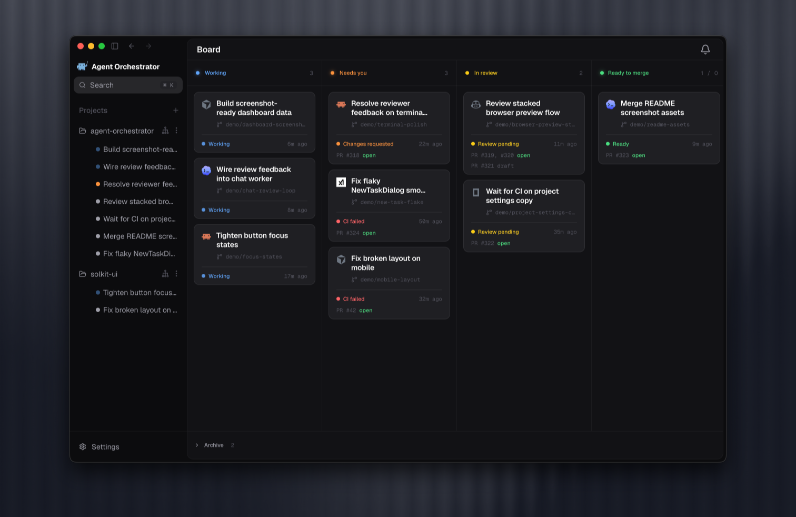

## A workspace for agent-driven development

One coding agent can handle a task. Running several across a project creates a different job: deciding what matters, splitting work cleanly, giving each agent the right context, preventing branch collisions, and following every change through review and merge.

Project-Aware-Agent-Orchestrator is a local desktop workspace built for that job. Add a repository and create a worker session with the coding agent, model, and interface that fit the task. For Git-backed work, Project-Aware-Agent-Orchestrator gives the worker its own branch and worktree. The task, conversation, terminal, changed files, browser preview, pull request, CI, and review state stay attached to that session from start to finish.

Behind the desktop app, Project-Aware-Agent-Orchestrator's local daemon watches agent activity and source-control state. The result is a shared, live view of the project instead of a collection of disconnected terminals, branches, and browser tabs.

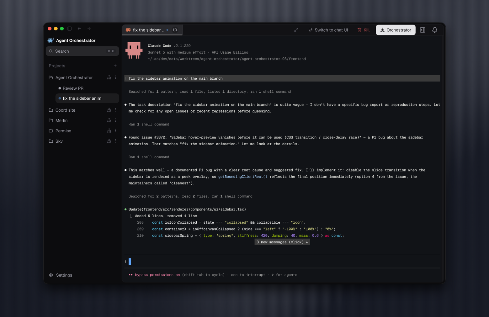

## Workers execute focused tasks

A worker is Project-Aware-Agent-Orchestrator's unit of execution: one task, one coding agent, and one isolated workspace. Use **New task** when the work is already clear. Describe the outcome, choose an agent and model, attach relevant files, and work with the agent in structured Chat or its native terminal UI.

Open a worker at any time to continue the conversation, attach to its terminal, inspect its changes, use its isolated browser, review its pull request, or send CI and review feedback back to the same agent. This makes each task independently understandable and keeps parallel work from collapsing into one shared context.

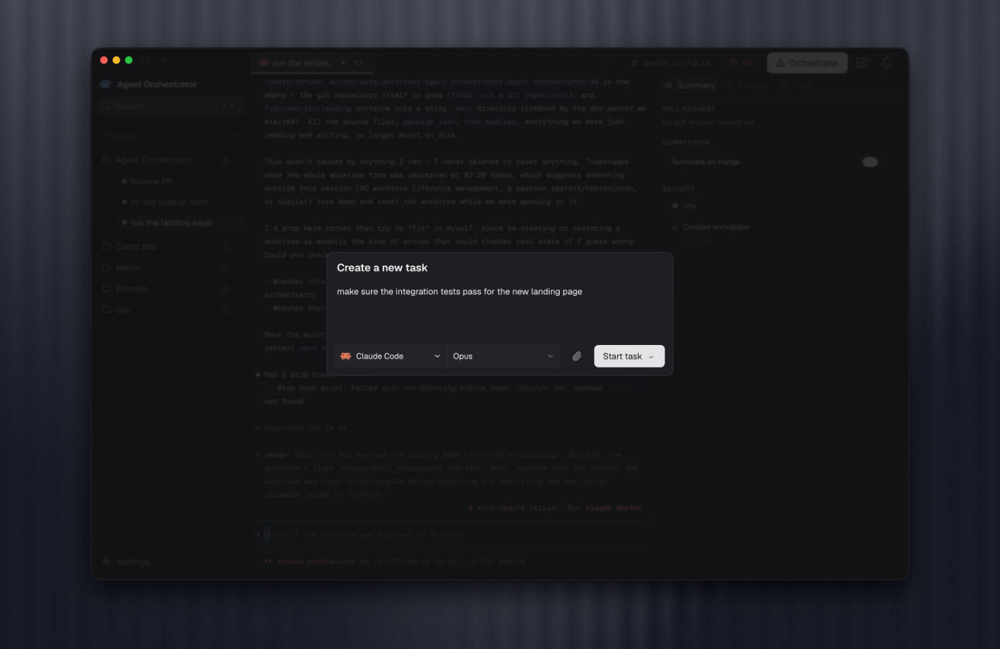

## The orchestrator plans across the project

The project orchestrator is Project-Aware-Agent-Orchestrator's persistent planning and coordination agent. It works at the level above individual tasks: the product direction, technical strategy, priorities, and sequence of work across the repository.

Use the orchestrator to explore an idea before implementation, brainstorm product and technical approaches, reason through tradeoffs, identify high-impact work, and turn an ambiguous outcome into a concrete plan. Its project-scoped conversation preserves goals, decisions, constraints, and earlier reasoning. It combines that planning history with repository context and live Project-Aware-Agent-Orchestrator state, including active workers, ownership, pull requests, CI, and reviews. This keeps planning grounded in both the project and the work already underway.

When a plan becomes actionable, the orchestrator can break it into focused tasks, spawn or redirect workers, pass each worker the relevant context, follow their progress, and coordinate follow-up work. The orchestrator owns planning and delegation; workers own implementation, tests, commits, and pull requests.

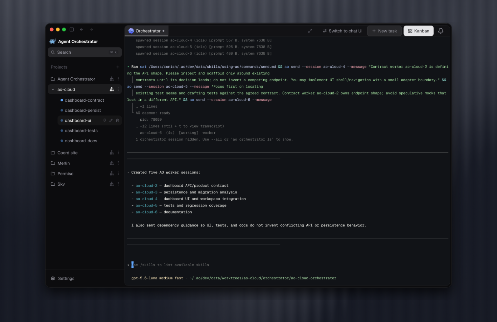

## The Kanban keeps the system legible

Every worker appears on the same live board, whether you started it from **New task** or the orchestrator delegated it. Project-Aware-Agent-Orchestrator derives each card's position from session, pull request, CI, and review facts, turning the Kanban into an operational view of the project:

- **Working:** workers that are actively implementing or ready for another instruction
- **Needs you:** blocked sessions, missing input, failed CI, requested changes, or lost signals
- **In review:** open and draft pull requests waiting on checks or review
- **Ready to merge:** approved or mergeable work, with merged sessions kept visible until they are archived

Each card keeps the task, agent, branch, activity, pull request, and status together. Open it to inspect the conversation or terminal, changed files, PR summary, reviews, and preview. The board shows what is moving, what is blocked, and where your attention will have the most impact.

## One workflow, from idea to merge

1. **Start at the right level.** Give a clear task directly to a worker, or develop a larger outcome with the project orchestrator and let it shape the plan.
2. **Delegate focused work.** Start workers yourself or have the orchestrator create them with the context and ownership they need.
3. **Build in isolation.** Every Git-backed worker gets its own branch and worktree; standalone agents get Project-Aware-Agent-Orchestrator-managed branchless directories without requiring a project or repository.
4. **Supervise live state.** Project-Aware-Agent-Orchestrator follows agent activity, pull requests, CI, review feedback, and merge conflicts, then reflects those facts on the Kanban.
5. **Close the feedback loop.** Inspect any worker directly, make project-level decisions with the orchestrator, and return actionable failures or review comments to the agent that owns the work.

Project-Aware-Agent-Orchestrator works with the coding agents and source-control workflow you already use. Agents keep their native strengths; Project-Aware-Agent-Orchestrator supplies the project context, isolated execution, coordination, and operational view that make them work as a system.

## Product highlights

<table>
  <tr>
    <td width="36%" valign="middle">
      <h3>Pull requests and agent reviews</h3>
      
Keep CI, mergeability, reviewer state, and interactive agent reviews beside the worker, then return requested changes to the same owner.

    </td>
    <td width="64%">
      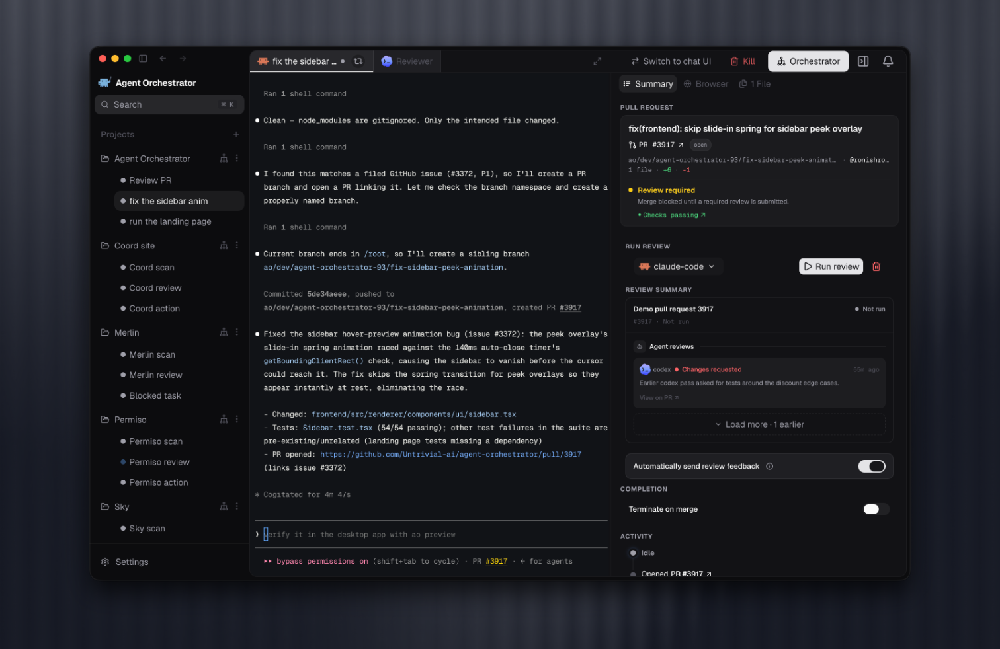
    </td>
  </tr>
  <tr>
    <td width="36%" valign="middle">
      <h3>Agent-controllable browser</h3>
      
Preview and inspect a worker's local app beside its interface. Temporary browser profiles are isolated per worker; named profiles deliberately reuse saved cookies and storage across sessions.

    </td>
    <td width="64%">
      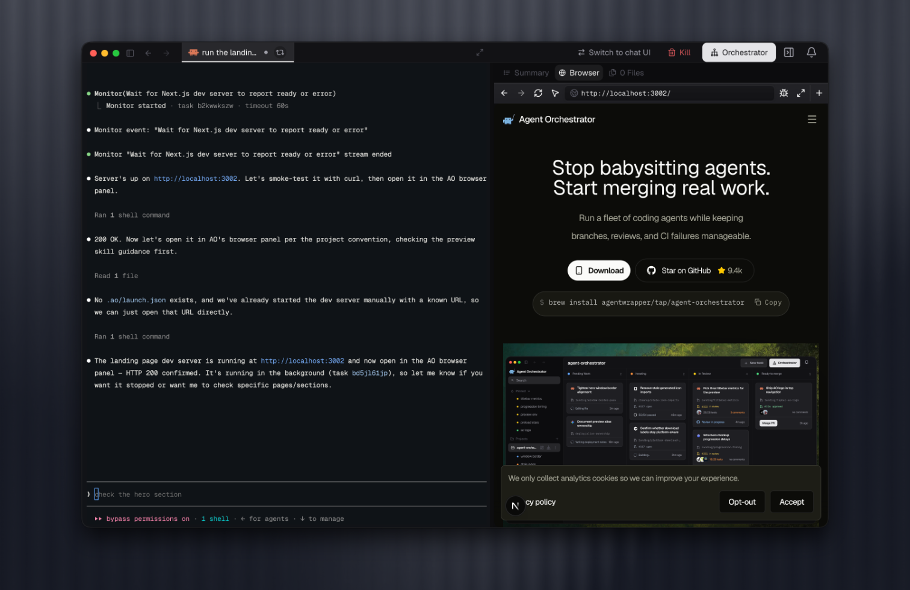
    </td>
  </tr>
  <tr>
    <td width="36%" valign="middle">
      <h3>Native interfaces, one supervisor</h3>
      
Use structured Chat or the agent's native terminal UI while Project-Aware-Agent-Orchestrator keeps task context, workspace state, and feedback in one place.

    </td>
    <td width="64%">
      
    </td>
  </tr>
</table>

## Supported agents

**Coding agent harnesses in one supervised workflow.** Worker, Chat, and reviewer support differ; see the capability catalog linked below for the current matrix.

<table>
  <tr valign="middle">
    <td width="33%" valign="middle" nowrap> &nbsp; <b>Claude Code</b></td>
    <td width="33%" valign="middle" nowrap>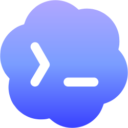 &nbsp; <b>Codex</b></td>
    <td width="33%" valign="middle" nowrap> &nbsp; <b>Cursor</b></td>
  </tr>
  <tr valign="middle">
    <td valign="middle" nowrap> &nbsp; <b>opencode</b></td>
    <td valign="middle" nowrap>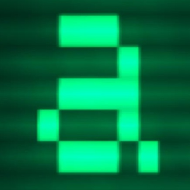 &nbsp; <b>Aider</b></td>
    <td valign="middle" nowrap> &nbsp; <b>GitHub Copilot</b></td>
  </tr>
  <tr valign="middle">
    <td valign="middle" nowrap> &nbsp; <b>Grok</b></td>
    <td valign="middle" nowrap> &nbsp; <b>Kimi</b></td>
    <td valign="middle" nowrap>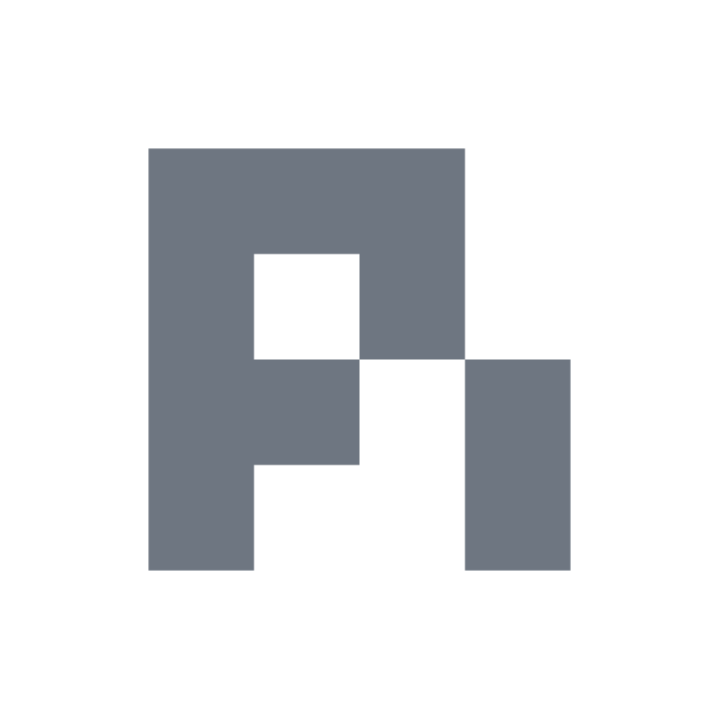 &nbsp; <b>Pi</b></td>
  </tr>
  <tr valign="middle">
    <td valign="middle" nowrap>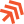 &nbsp; <b>Amp</b></td>
    <td valign="middle" nowrap>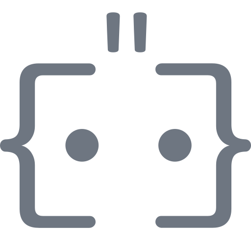 &nbsp; <b>Auggie</b></td>
    <td valign="middle" nowrap> &nbsp; <b>Droid</b></td>
  </tr>
  <tr valign="middle">
    <td valign="middle" nowrap>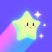 &nbsp; <b>Crush</b></td>
    <td valign="middle" nowrap> &nbsp; <b>Cline</b></td>
    <td valign="middle" nowrap> &nbsp; <b>Goose</b></td>
  </tr>
  <tr valign="middle">
    <td valign="middle" nowrap>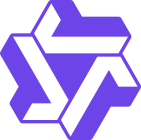 &nbsp; <b>Qwen</b></td>
    <td valign="middle" nowrap> &nbsp; <b>Continue</b></td>
    <td valign="middle" nowrap> &nbsp; <b>Devin</b></td>
  </tr>
  <tr valign="middle">
    <td valign="middle" nowrap> &nbsp; <b>Kiro</b></td>
    <td valign="middle" nowrap> &nbsp; <b>Kilo Code</b></td>
    <td valign="middle" nowrap> &nbsp; <b>Vibe</b></td>
  </tr>
  <tr valign="middle">
    <td valign="middle" nowrap>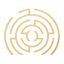 &nbsp; <b>Muse</b></td>
    <td valign="middle" nowrap> &nbsp; <b>Agy</b></td>
    <td valign="middle" nowrap><picture><source media="(prefers-color-scheme: dark)" srcset="docs/assets/readme/agents/autohand-stacked-dark.png" />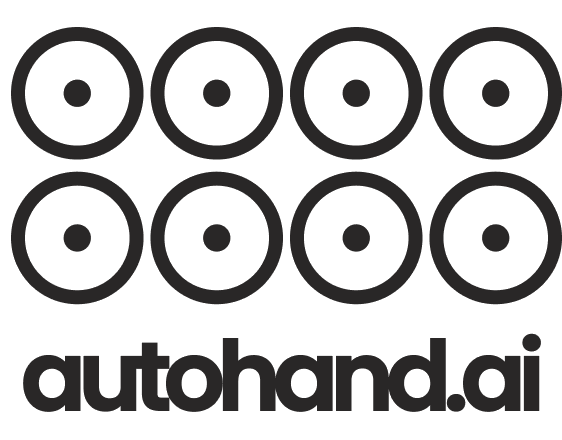</picture> <b>Autohand</b></td>
  </tr>
  <tr valign="middle">
    <td valign="middle" nowrap> &nbsp; <b>Kimchi</b></td>
    <td valign="middle" nowrap> &nbsp; <b>Prime Agent</b></td>
    <td valign="middle" nowrap>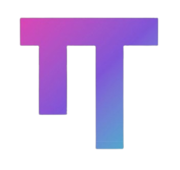 &nbsp; <b>OMP</b></td>
  </tr>
  <tr valign="middle">
    <td valign="middle" nowrap> &nbsp; <b>fx</b></td>
    <td valign="middle" nowrap>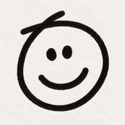 &nbsp; <b>Unreal Agent</b></td>
    <td valign="middle" nowrap>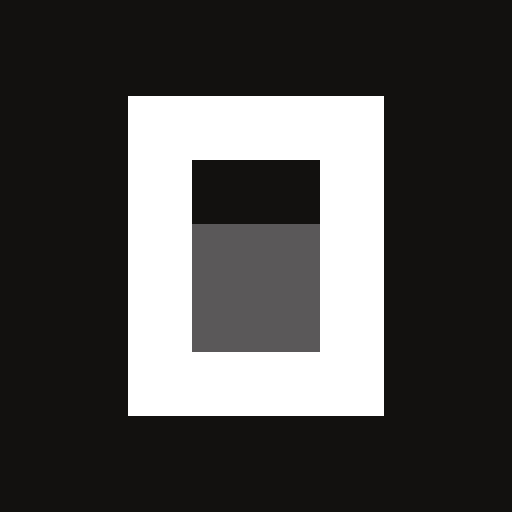 &nbsp; <b>MiMo Code</b></td>
  </tr>
  <tr valign="middle">
    <td valign="middle" nowrap> &nbsp; <b>Gemini CLI</b></td>
    <td valign="middle" nowrap> &nbsp; <b>DeepSeek</b></td>
    <td valign="middle" nowrap> &nbsp; <b>OpenCode 2</b></td>
  </tr>
  <tr valign="middle">
    <td valign="middle" nowrap>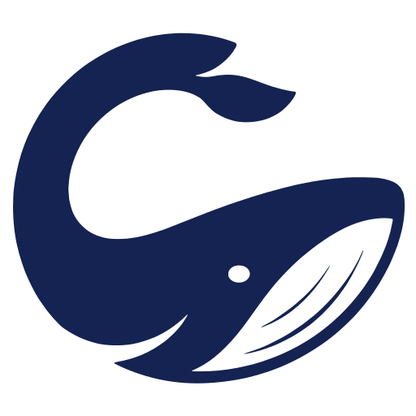 &nbsp; <b>Codewhale</b></td>
  </tr>
</table>

## License

Project-Aware-Agent-Orchestrator is available under the [Apache License 2.0](LICENSE).
